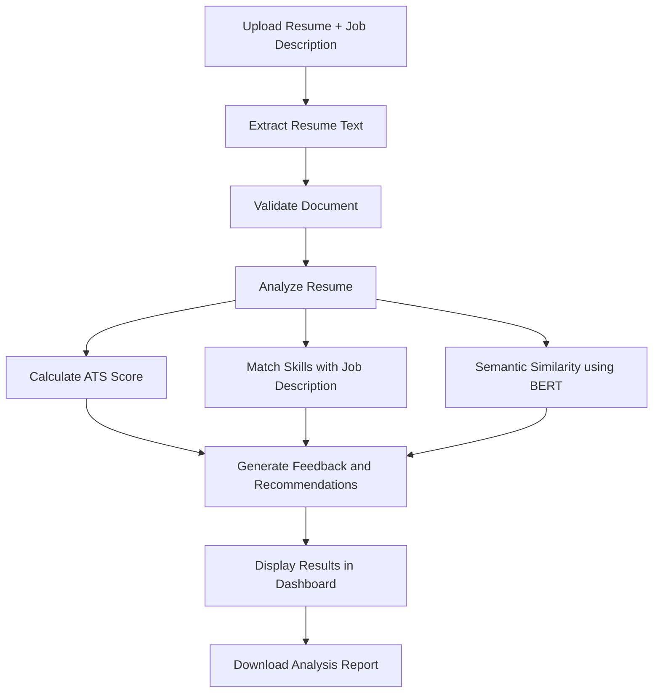

# ATS Resume Analyzer

A resume analysis tool that compares a candidate's resume with a job
description and highlights how well the two align.

The application combines a Streamlit interface, a FastAPI backend,
NLP-based matching, and AI-assisted feedback to help candidates identify
skill gaps and improve their resumes.

## What it does

- Extracts text from uploaded resumes.
- Calculates an ATS-style score using the project's scoring logic.
- Compares resume content with a target job description.
- Uses a fine-tuned Sentence-BERT model for semantic similarity.
- Identifies relevant skills that may be missing or underrepresented.
- Generates feedback and improvement suggestions using the Groq API.
- Displays results in a dashboard and supports report generation.

The score is intended as a resume-improvement aid. It is not a
prediction of whether an employer will shortlist or hire a candidate.

## Resume analysis workflow

The diagram below shows the path from resume upload to the final report:



## Technology stack

Layer Technology

---

Frontend Streamlit
Backend API FastAPI, Uvicorn
NLP and semantic matching Sentence Transformers, fine-tuned BERT
AI feedback Groq API
Authentication and data Supabase
Templates and reports Jinja2 and PDF utilities

## Project structure

```text
ATS_SCORER/
├── backend/
│   ├── api/             # API routes and authentication
│   ├── core/            # Application configuration
│   ├── database/        # Supabase integration
│   ├── models/          # Request and response schemas
│   ├── services/        # Parsing, scoring, matching, feedback
│   ├── templates/       # Report templates
│   ├── utils/           # Shared utilities
│   └── main.py           # FastAPI application
├── frontend/
│   ├── assets/
│   ├── components/       # Reusable UI components
│   ├── services/         # API and Supabase clients
│   ├── views/            # Application pages
│   └── streamlit_app.py  # Streamlit entry point
├── jupyter notebook/      # EDA and model development notebooks
├── ml_model/
│   └── finetuned-bert/   # Model configuration and tokenizer
├── requirements.txt
└── README.md
```

## Run locally

### Requirements

- Python 3.10 or newer
- Git
- Groq API credentials
- Supabase project credentials
- Fine-tuned model weights

### 1. Clone the repository

````bash
git clone https://github.com/subhajitjana15112003/ATS_SCORER.git
cd ATS_SCORER

### 2. Create and activate a virtual environment

Windows PowerShell:

``` powershell
python -m venv venv
.\venv\Scripts\Activate.ps1
````

### 3. Install dependencies

```powershell
python -m pip install --upgrade pip
python -m pip install -r requirements.txt
python -m pip install -r backend/requirements.txt
```

### 4. Configure environment variables

Create a `.env` file in the project root and add the credentials
required by your configuration:

```env
GROQ_API_KEY=your_groq_api_key
SUPABASE_URL=https://your-project.supabase.co
SUPABASE_KEY=your_supabase_key
```

Check `backend/core/config.py` and the Supabase client for the exact
variable names expected by your local version. Keep `.env` out of Git.

### 5. Add the model weights

The trained `model.safetensors` file is approximately 438 MB and is not
included in this repository.

Place the weights at:

```text
ml_model/finetuned-bert/model.safetensors
```

The model configuration and tokenizer files are included. If you do not
have the weights, obtain them from your training output or retrain using
the notebooks in `jupyter notebook/`.

### 6. Start the backend

From the repository root:

```powershell
python -m uvicorn backend.main:app --reload
```

The API runs at `http://127.0.0.1:8000`.

Interactive API documentation:

- Swagger UI: `http://127.0.0.1:8000/docs`
- ReDoc: `http://127.0.0.1:8000/redoc`

### 7. Start the frontend

Open a second terminal, activate the virtual environment, and run:

```powershell
python -m streamlit run frontend/streamlit_app.py
```

Open the local URL printed by Streamlit, usually
`http://localhost:8501`.

Keep the backend running while using the frontend.

## API endpoint

The resume analysis route is:

```http
POST /api/v1/analyze-resume
```

Use the Swagger interface at `/docs` to inspect the request fields,
upload format, and authentication requirements.

## Model development

The notebooks contain the model development workflow:

- `EDA&DATAPREP.ipynb` --- data exploration and preparation
- `BERT_FINE_TUNE.ipynb` --- fine-tuning
- `BERTMODEL.ipynb` --- model experiments

The fine-tuned model supports semantic matching. Its output is one part
of the overall analysis and should be interpreted alongside the other
scoring components.

## Notes

- Scores depend on resume parsing, scoring rules, and the supplied job
  description.
- Semantic similarity measures textual relevance; it does not verify a
  candidate's qualifications.
- AI-generated feedback may be incomplete and should be reviewed.
- Do not upload resumes or credentials to a public repository.
- Model weights must be obtained or generated separately.

## License

Add a `LICENSE` file if you intend to distribute this project under a
specific open-source license.

## Author

SUBHAJIT JANA
GitHub: https://github.com/subhajitjana15112003/ATS_SCORER
